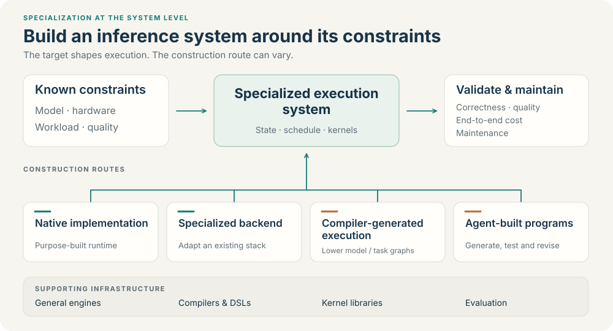

# Awesome Inference Specialization

**Specialized inference systems: what they exploit, how they are built, and what they cost to validate and maintain.**

[中文](README_CN.md) · [Systems & construction](docs/systems.md) · [Mechanism index](docs/catalog.md) · [Compare](docs/comparison.md) · [Research questions](docs/research-agenda.md) · [Contribute](CONTRIBUTING.md)

## Why this repository?

**When the model, hardware and workload are known, which parts of inference should become specialized—and how should the resulting system be built?**

Known constraints create opportunities: a fixed MoE structure, a limited memory budget, a chosen numerical format, or a recurring generation pattern can justify a different execution design. This collection connects those opportunities to inspectable systems and the workflows that construct them.

Use it to:

- **Find specialization opportunities:** connect a deployment constraint to a concrete change in execution, state or data movement.
- **Choose an implementation boundary:** compare a native runtime, a backend within a shared engine, compiler-generated execution and agent-guided construction.
- **Evaluate the full trade-off:** examine performance and quality alongside validation effort, integration, portability and maintenance.

Compilers and coding agents may reduce construction effort. Whether those savings outweigh verification and maintenance costs remains an open research question; the catalog supplies examples and evidence for investigating it.

## Start with systems and their construction

<!-- CATALOG-START -->

**98 entries: 34 Specialized inference systems · 9 Ways to construct specialized systems · 55 Supporting infrastructure and references**

Start with the constraints a system exploits, then follow its construction. Browse all entries by [reading role](docs/systems.md); the eight mechanism families remain a cross-cutting index.

### Specialized inference systems

| Specialization opportunity | Representative systems | Execution decision |
| --- | --- | --- |
| Known model structure | [DwarfStar](docs/catalog.md#dwarfstar), [Iris](docs/catalog.md#iris), [Inferix](docs/catalog.md#inferix) | Tailor model execution and generation state to selected architectures. |
| Device and memory limits | [KTransformers / kt-kernel](docs/catalog.md#ktransformers), [Strata](docs/catalog.md#strata) | Choose which experts reside or execute on each device. |
| Chosen numerical formats | [ExLlamaV3](docs/catalog.md#exllamav3), [Nunchaku](docs/catalog.md#nunchaku) | Co-design quantized representations and their execution paths. |
| Known workload structure | [DistServe](docs/catalog.md#distserve), [xDiT](docs/catalog.md#xdit) | Organize prefill/decode stages or DiT work across devices. |

### Four construction routes

| Route | What is built and how | Cases |
| --- | --- | --- |
| Native implementation | Implement the selected model graph and runtime policy; reuse lower-level libraries where useful. | [DwarfStar](docs/catalog.md#dwarfstar), [Iris](docs/catalog.md#iris) |
| Specialized backend | Keep shared framework services and replace a substantial execution subsystem. | [KTransformers / kt-kernel](docs/catalog.md#ktransformers), [Nunchaku](docs/catalog.md#nunchaku) |
| Compiler-generated execution | Lower a model or task graph into target-specific programs and runtime schedules. | [Mirage Persistent Kernel](docs/catalog.md#mirage), [MLC LLM](docs/catalog.md#mlc-llm) |
| Agent-guided construction | Generate or revise kernels and servers, then inspect the resulting validation and integration. | [MetaInfer](docs/catalog.md#metainfer), [Sol-Engine](docs/catalog.md#sol-engine), [KernelAgent](docs/catalog.md#kernelagent) |

Routes can be combined. Agent involvement does not establish a faster artifact; passing tests establishes behavior only within their validation scope.

### Supporting infrastructure and references

These projects supply reusable components, comparison baselines and evaluation conditions for the systems above.

- **General-engine baselines:** [vLLM](docs/catalog.md#vllm), [SGLang](docs/catalog.md#sglang), [TensorRT-LLM](docs/catalog.md#tensorrt-llm), [llama.cpp](docs/catalog.md#llama-cpp).
- **Compilers and languages:** [Apache TVM](docs/catalog.md#tvm), [IREE](docs/catalog.md#iree), [Triton](docs/catalog.md#triton), [TileLang](docs/catalog.md#tilelang).
- **Reusable kernels and components:** [FlashAttention](docs/catalog.md#flash-attention), [FlashInfer](docs/catalog.md#flashinfer), [LMCache](docs/catalog.md#lmcache).
- **Evaluation and integration checks:** [KernelBench](docs/catalog.md#kernelbench), [FastKernels](docs/catalog.md#fastkernels), [Spec-Bench](docs/catalog.md#spec-bench).

### Continue by mechanism

[Data residency & movement (11)](docs/catalog.md#memory) · [Numerical representation (9)](docs/catalog.md#precision) · [Selective computation (8)](docs/catalog.md#selection) · [Computation reuse (10)](docs/catalog.md#reuse) · [Generation order (5)](docs/catalog.md#decoding) · [Parallelism & scheduling (12)](docs/catalog.md#serving) · [Compiled & native execution (32)](docs/catalog.md#execution) · [Construction & validation tools (11)](docs/catalog.md#construction)

Source review: 2026-10-12. Featured cases are reading entry points, not a performance or maturity ranking.

<!-- CATALOG-END -->

## Read each project as a design decision

**Constraint → execution change → deployed or generated artifact → validation → maintenance cost.**

For example, limited GPU memory can motivate executing nonresident experts on the CPU, as in [KTransformers](docs/catalog.md#ktransformers), or transferring and caching expert weights, as in [MoE-Infinity](docs/catalog.md#moe-infinity). The same constraint leads to different data movement and execution choices. A useful comparison must fix the model, quality target, hardware and workload, then include integration and operating costs.

The [mechanism guide](docs/taxonomy.md) explains the eight secondary families with a landscape map and execution-path diagrams. Modality, artifact type, semantic changes and source access remain separate labels. Quantization, caching or compilation belongs in the discussion when its deployment assumptions and execution consequences are explicit.

## What belongs here?

The main subjects are **specialized inference systems and concrete workflows that build them**. A system record should identify the constraint it exploits, the execution path it controls and the artifact it delivers. A construction record should identify its inputs, generated or adapted program, and validation boundary.

General engines, compilers, kernel libraries, optimization components and benchmarks provide baselines and reusable foundations. Their supporting role explains how specialized systems are assembled and compared. The three reading roles do not rank quality or maturity; a specialized backend can be a central case without implementing an entire server.

Every record retains direct sources and limitations. This is a source-reviewed collection; no cross-project performance ranking or independent benchmark reproduction is claimed. See the [evidence policy](docs/evidence-policy.md) and [survey record](docs/survey-2026-10-12.md).

## Research and maintenance

The [research agenda](docs/research-agenda.md) asks where specialization pays, which construction route fits, and what survives a change of model, device or load. The [reading list](docs/reading-list.md) supplies further context. Corrections, missing systems and independently reproduced negative results are welcome.

The [CSV catalog](catalog/projects.csv) supplies the role index, mechanism catalog, comparison view and both homepage selections. See [CONTRIBUTING.md](CONTRIBUTING.md) for maintenance. Metadata, original diagrams, commentary and scripts use the [MIT License](LICENSE); linked projects and models retain their own licenses.
