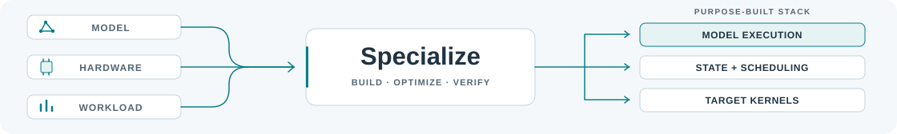

<picture>
  <source media="(max-width: 600px) and (prefers-color-scheme: dark)" srcset="assets/header-dark-compact.svg">
  <source media="(max-width: 600px)" srcset="assets/header-light-compact.svg">
  <source media="(prefers-color-scheme: dark)" srcset="assets/header-dark.svg">
  
</picture>

# Awesome Inference Specialization

**专用执行栈 · 共享基础 · 构建与验证**

收录面向特定模型、硬件与负载的执行栈，探索 **AI 辅助编程** 是否改变了哪些专用系统值得构建。

<!-- CATALOG-START -->

121 个项目 · 89 个引擎 · 11 个构建流程 · 3 个基准 · 18 项资源

[引擎](#homepage-system) · [构建](#homepage-construction) · [验证](#homepage-validation) · [基准](#homepage-benchmark) · [资源](#homepage-support) · [深入阅读](#further-reading) · [English](README.md)

模型领域：[语言](#homepage-system-text) · [图像](#homepage-system-image) · [视频](#homepage-system-video) · [音频](#homepage-system-audio) · [多模态](#homepage-system-multimodal)

## 六种专用化路径

<!-- STARTER-GRID-START -->
<table align="center">
<tr>
<td width="33%" valign="top">
01 / Agent 构建引擎

**[Vibe<wbr>Qwen](docs/cases.md#vibeqwen)** 
从工作流到模型服务。

</td>
<td width="33%" valign="top">
02 / 原生运行时

**[Splash](docs/cases.md#splash)** 
Metal 内核、状态与服务。

</td>
<td width="33%" valign="top">
03 / 深度分叉

**[llam<wbr>Ampere](docs/cases.md#llamampere)** 
复用服务，重构执行。

</td>
</tr>
<tr>
<td width="33%" valign="top">
04 / 专用后端

**[Nun<wbr>chaku](docs/cases.md#nunchaku)** 
低比特权重与融合执行。

</td>
<td width="33%" valign="top">
05 / 编译生成执行

**[Mirage MPK](docs/cases.md#mirage)** 
任务图到常驻 GPU 程序。

</td>
<td width="33%" valign="top">
06 / 视频优化流程

**[Sol-Engine](docs/cases.md#sol-engine)** 
搜索、验证与集成。

</td>
</tr>
</table>
<!-- STARTER-GRID-END -->

[12 案例对照](docs/representative-comparison.md#chinese) · [跨案例综合](docs/synthesis.md) · 阅读选例，不是排名。

## 推理引擎

全部项目展开，名称直达上游。[执行边界](docs/systems.md#system) · [跨领域索引](docs/domains.md)

### 语言模型 · 49

- **[ANE-LM](https://github.com/johnmai-dev/ANE-LM)** — 作为 ane.cpp 的直接前身，以编译缓存连接 Qwen 的 ANE 内核与 CPU 运算，保留私有接口和有限模型范围的约束。 [详情](docs/catalog.md#ane-lm)
- **[ane.cpp](https://github.com/skyfallsin/ane.cpp)** — 通过硬件探针和保留／舍弃实验，将 Qwen 卷积编译到 ANE，并由 CPU 处理归一化、注意力与 KV 状态。 [详情](docs/catalog.md#ane-cpp)
- **[ANEMLL Flash llama.cpp](https://github.com/Anemll/anemll-flash-llama.cpp)** — 在 llama.cpp 分支中加入专家旁路文件、槽位映射和按层预填充；可选缩减 top-k 与仅共享专家模式会改变计算。 [详情](docs/catalog.md#anemll-flash-llama)
- **[BaseRT](https://github.com/basecompute/baseRT)** — 公开转换器、C API 与语言绑定围绕专有原生引擎部署模型；执行核心未公开，内核机制与性能依赖作者文档。 多模态 · [详情](docs/catalog.md#basert)
- **[bitnet.cpp](https://github.com/microsoft/BitNet)** — 围绕兼容的三值模型，以压缩低比特内核、查找表及形状专化执行；其无损表述针对已有三值表示，不适用于任意浮点模型。 [详情](docs/catalog.md#bitnet-cpp)
- **[Cactus Needle](https://github.com/cactus-compute/needle)** — 将可切分注意力模型、量化权重与平台原生引擎配套分发；仓库公开模型和打包代码，未公开所分发 C++ 引擎实现。 音频 · [详情](docs/catalog.md#needle)
- **[CIRU runtime](https://github.com/ciru-ai/Qwen3.8-Flash-CIRU-STRIX-IU4)** — 在 llama.cpp 衍生运行时中整合专家分页、专用内核、稀疏注意力和推测状态修正，模型格式与特定发布构建紧密耦合。 多模态 · [详情](docs/catalog.md#ciru-runtime)
- **[CoreML LLM CLI](https://github.com/smpanaro/coreml-llm-cli)** — 以分块 Core ML 执行、KV 状态和 IOSurface 缓冲区编排 Llama 2，呈现 ANEMLL 之前的编译模型与宿主运行时适配。 [详情](docs/catalog.md#coreml-llm-cli)
- **[DeepSpeed ZeRO-Inference](https://github.com/deepspeedai/DeepSpeedExamples)** — 将 CPU 或 NVMe 中的权重逐层送入 GPU，以预取和大批量摊薄传输开销，展示早于近期编程智能体的吞吐型卸载路线。 [详情](docs/catalog.md#zero-inference)
- **[DwarfStar](https://github.com/antirez/ds4)** — 披露 AI 辅助构建的原生运行时，为选定模型保留非路由状态，并用有界 SSD 缓存读取专家；其模型与后端支持具有明确边界。 [详情](docs/catalog.md#dwarfstar)
- **[ExLlamaV3](https://github.com/turboderp-org/exllamav3)** — 围绕 EXL3 表示整合低比特执行、量化分页 KV 和形状限定解码路径，展示专用运行时重构，数值与支持范围取决于配置。 [详情](docs/catalog.md#exllamav3)
- **[Fiddler](https://github.com/efeslab/fiddler)** — 面向小批量 Mixtral 推理，将未驻留专家留在 CPU 计算并传输激活，用于比较异构计算与搬运专家权重两种路线。 [详情](docs/catalog.md#fiddler)
- **[Flash-MoE](https://github.com/danveloper/flash-moe)** — 披露 AI 辅助构建的 Qwen 专用 Metal 实现，从 SSD 流式读取量化专家，但将十个激活专家缩减为四个，含近似取舍。 [详情](docs/catalog.md#flash-moe)
- **[FlexLLMGen (FlexGen)](https://github.com/FMInference/FlexLLMGen)** — 面向 OPT 的吞吐型运行时，通过 GPU、CPU 与磁盘分层、跨微批权重复用和传输重叠调度执行，不代表通用低延迟表现。 [详情](docs/catalog.md#flexllmgen)
- **[Gufo RDMA](https://github.com/neuhaus/gufo)** — 将 Gufo 扩展到两台 Strix Halo，以模型张量分区、RDMA 集合通信和镜像请求保持跨主机执行与推测状态同步。 多模态 · [详情](docs/catalog.md#gufo-rdma)
- **[Halogen Flash](https://github.com/peonist-ai/halogen-flash-server)** — 面向指定 Qwen 模型与芯片，以混合精度、分页 n-gram 查找和专用专家执行提供二进制运行时；核心闭源，公开资料无法验证全部实现。 [详情](docs/catalog.md#halogen-flash)
- **[Hilum LLM Engine](https://github.com/hilum-labs/hilum-local-llm-engine)** — 在 llama.cpp/GGML 基础上接入移动端 Adreno、Vulkan 与 Metal 路径，调整着色器调度、内存分配和设备参数。 多模态 · [详情](docs/catalog.md#hilum-engine)
- **[hipEngine](https://github.com/shisa-ai/hipEngine)** — 由 Python 宿主驱动 HIP/C++ 模型内核、共享 KV 状态和连续批处理，面向指定 AMD 设备重建不依赖 PyTorch 的推理路径。 音频 · 多模态 · [详情](docs/catalog.md#hipengine)
- **[HybriMoE](https://github.com/PKU-SEC-Lab/HybriMoE)** — 基于 KTransformers 组合 CPU/GPU 专家调度、预取与缓存策略，为超显存 MoE 的专家放置和搬运提供既有参考。 [详情](docs/catalog.md#hybrimoe)
- **[ik_llama.cpp](https://github.com/ikawrakow/ik_llama.cpp)** — 在 llama.cpp 分支中扩展压缩量化格式、CPU IQK 内核和 CUDA 分派，展示保留通用引擎兼容性与专用执行的取舍。 [详情](docs/catalog.md#ik-llama)
- **[imp](https://github.com/kekzl/imp)** — 面向 RTX 5090 级设备重建 C++/CUDA 模型执行、分页 KV、图调度与服务，作者明确披露由编程代理端到端实现。 多模态 · [详情](docs/catalog.md#imp)
- **[Infernix](https://github.com/wallawalla47/infernix)** — 在 NInfer 分支中组合 GPU 热专家缓存、CPU 缺失专家计算、PCIe 重叠传输及 NVMe 存储，作者披露 AI 辅助开发。 多模态 · [详情](docs/catalog.md#infernix)
- **[Kipp](https://github.com/Polished-Snow/Kipp)** — 以 C11 重建严格检查点加载、分词、模型执行、分页 KV 与批处理服务，通过隔离的 Metal/CUDA 后端维持模型契约。 [详情](docs/catalog.md#kipp)
- **[KTransformers / kt-kernel](https://github.com/kvcache-ai/ktransformers)** — 以 CPU 指令集专用内核和 NUMA 布局执行内存密集型 MoE 专家，并复用 GPU 服务设施，展示异构后端的重构边界。 [详情](docs/catalog.md#ktransformers)
- **[Lily](https://github.com/perplexityai/pplx-garden/tree/main/lily)** — 以 Rust／Metal 自建单一 Qwen 量化检查点的预填充、解码与前缀缓存，明确展示重构的兼容性代价，接口限纯文本贪心非流式输出。 [详情](docs/catalog.md#lily)
- **[Lithos Metal](https://github.com/lithos-ai/lithos-metal)** — 将类型化模型图编译为层融合巨型内核及常规内核，以 Metal 间接命令和 GPU 驻留草稿状态执行，部分后端与融合数值仍有限定。 [详情](docs/catalog.md#lithos-metal)
- **[llamAmpere](https://github.com/JakeATX/llamAmpere)** — 在 llama.cpp 深度分支中结合 Ampere 专用验证内核、MTP 草稿和压缩 KV，保留共享服务；后训练模型与量化变化需与引擎贡献分开。 [详情](docs/catalog.md#llamampere)
- **[Llaminar](https://github.com/Llaminar/llaminar)** — 原生构建模型计算图和设备执行计划，跨 CPU、NVIDIA 与 AMD 放置模型阶段和专家，并显式协调异构通信。 [详情](docs/catalog.md#llaminar)
- **[Magnitude](https://github.com/magnitudedev/magnitude)** — 已审查的 Metal／MLX 路径将类型化操作映射到兼容内核方案，并生成专化融合入口，展示专用推理栈边界，不外推至其他后端。 [详情](docs/catalog.md#magnitude)
- **[memra](https://github.com/avifenesh/memra)** — 以 Rust 宿主连接预编译 CUDA 内核与模型专用程序，显式管理量化、KV 和多卡放置，并按模型及设备设置精度验证。 多模态 · [详情](docs/catalog.md#memra)
- **[MetalChat](https://github.com/ybubnov/metalchat)** — 以 C++/Metal 张量、层和模型抽象构建原生生成路径，作为可复用框架的邻近案例，生成测试不等于完整质量验证。 [详情](docs/catalog.md#metalchat)
- **[MoE-Infinity](https://github.com/EfficientMoE/MoE-Infinity)** — 将专家权重分层卸载，以激活感知缓存保留热点专家并按轨迹预取，作为既有专家驻留策略的对照，公开实现与论文系统有别。 [详情](docs/catalog.md#moe-infinity)
- **[NInfer](https://github.com/Neroued/ninfer)** — 为指定 Qwen 模型在单张 RTX 5090 上自建原生执行、KV 状态和 CUDA 图，并管理请求与缓存；代理指令文件不构成 AI 作者证据。 多模态 · [详情](docs/catalog.md#ninfer)
- **[NInfer-3090](https://github.com/ashalliants/ninfer-3090)** — 将 NInfer 分支适配至 24GB RTX 3090，重建 SM86 量化内核、内存规划和回放状态，超出单纯更改编译架构的范围。 多模态 · [详情](docs/catalog.md#ninfer-3090)
- **[PowerInfer](https://github.com/Tiiny-AI/PowerInfer)** — 依据神经元激活频率将热点放在 GPU、冷激活交给 CPU，并用预测器驱动稀疏算子；依赖兼容稀疏模型，不能直接套用任意稠密权重。 [详情](docs/catalog.md#powerinfer)
- **[ROCmFPX](https://github.com/ROCmFPX/ROCmFPX)** — 在 llama.cpp 下游定义 AMD 量化块、转换策略及匹配内核，展示格式与后端的协同构建，准确性依配方分别核验。 [详情](docs/catalog.md#rocmfpx)
- **[Saragossa](https://github.com/azerozero/saragossa)** — 以 Rust／Metal 为指定文本和语音模型自建执行、驻留解码状态、缓冲区及前缀快照，配有回归对照，聚焦 Apple 芯片单用户场景。 音频 · [详情](docs/catalog.md#saragossa)
- **[Splash](https://github.com/incoai/splash)** — 在 Apple 芯片上以模型专用 Metal 内核、草稿验证和前缀复用构建原生服务栈，披露的智能体辅助范围是内核生成，并非整个引擎。 多模态 · [详情](docs/catalog.md#splash)
- **[Strata](https://github.com/Niko1221/Strata)** — 面向指定 Qwen 模型，将注意力与热点专家留在 GPU，其余专家交由 CPU，并分层管理 KV；含专家跳过近似，AI 作者身份未证实。 [详情](docs/catalog.md#strata)
- **[strix-llama.cpp](https://github.com/halo-box/strix-llama.cpp)** — 在 llama.cpp 分支中加入 Strix Halo 专用融合内核与推测状态管理；可选推测预填充属近似执行，接受代理贡献不证明 AI 作者身份。 多模态 · [详情](docs/catalog.md#strix-llama-cpp)
- **[Swiftlet](https://github.com/leonickson1/Swiftlet)** — 以 Swift/Metal 重建部分 Qwen 混合 MoE 路径，结合专家容器、缓存与原生状态；作者披露 AI 辅助并记录参考验证。 [详情](docs/catalog.md#swiftlet)
- **[SwiftLM](https://github.com/SharpAI/SwiftLM)** — 在 MLX Swift 及维护分支中重构专家读取、异步 I/O 和生成同步边界，为超内存 MoE 增加显式 SSD 流式执行。 多模态 · [详情](docs/catalog.md#swiftlm)
- **[TensorFold](https://github.com/ashhart/TensorFold)** — 以原生 Zig 运行时执行限定模型与格式，按压缩布局契约读取权重并选择 Metal 或 CUDA 路径，投影融合以格式兼容为前提。 [详情](docs/catalog.md#tensorfold)
- **[TUFF](https://github.com/rexmhall09/TUFF)** — 在 Swift/Metal 流式运行时分支中加入特定模型前向路径、受限专家加载和独立服务，展示面向多类 MoE 的适配。 多模态 · [详情](docs/catalog.md#tuff)
- **[TurboFieldfare](https://github.com/drumih/turbo-fieldfare)** — 为受限内存 Apple 芯片上的 Gemma 自建运行时，以有界槽缓存读取路由专家并分块预填充，公开已采纳与放弃的构建实验。 多模态 · [详情](docs/catalog.md#turbo-fieldfare)
- **[Uzu](https://github.com/trymirai/uzu)** — 以 Rust 模型块管理解码状态并调度原生 Metal 内核，结合模型转换和生成绑定构成可复用端侧引擎，不据源码推定 AI 作者身份。 [详情](docs/catalog.md#uzu)
- **[vLLM Radiance](https://github.com/magiccodingman/vllm-radiance)** — 保留 vLLM 服务层，以固定版本补丁和 HIP 内核重建 RDNA4 关键路径；低比特算术与推测执行须单独验证等价性。 多模态 · [详情](docs/catalog.md#vllm-radiance)
- **[VTE](https://github.com/kyuubyN/VTE)** — 解析 GGUF、按模板生成 HIP 内核并管理显存与解码图回放，围绕消费级 RDNA3 的内存及驱动约束重建执行栈。 [详情](docs/catalog.md#vte)
- **[ZINC](https://github.com/zolotukhin/zinc)** — 以 Zig 统一管理模型加载、前向图、KV 状态和服务，再接入原生 Vulkan、HIP 等后端，各设备路径须分别验证。 [详情](docs/catalog.md#zinc)

[↑ 引擎目录](#homepage-system)

### 图像生成与处理 · 12

- **[brodiffusion](https://github.com/wlejon/brodiffusion)** — 以 C++ 管理图像模型加载、扩散流水线和采样器，在形状与状态契约允许时回放去噪图，底层复用 brotensor 后端。 [详情](docs/catalog.md#brodiffusion)
- **[diffusion-rs](https://github.com/EricLBuehler/diffusion-rs)** — 在可复用 Rust 张量层上实现 FLUX 组件加载、采样、量化及驻留策略，作为组件复用与卸载参考，不据此推定代理生成。 [详情](docs/catalog.md#diffusion-rs)
- **[Draw Things Community](https://github.com/drawthingsai/draw-things-community)** — 公开 Swift 模型图、采样器与硬件执行组件，并含 TeaCache 近似复用，展示本地生成应用路线，但不能据此认定完整产品均已开源。 视频 · [详情](docs/catalog.md#draw-things)
- **[edge-dit.cpp](https://github.com/THU-MIG/edge-dit.cpp)** — 在 ggml 上自建 DiT 图、组件驻留和分段卸载，配合量化与 VAE 分块重构受限内存执行路径，缓存和后端支持随模型变化。 视频 · [详情](docs/catalog.md#edge-dit)
- **[Hearth](https://github.com/jeff-hiner/hearth)** — 以 Rust 重建 SD 模型图、采样器及依赖有序执行，复用 CubeCL/wgpu 张量内核和设备访问，明确原生流水线的复用边界。 [详情](docs/catalog.md#hearth)
- **[Iris](https://github.com/antirez/iris.c)** — 以 C 与 Metal 或 CPU 内核实现指定图像模型流水线，使用权重映射并在条件生成后释放文本编码器，展示原生图与执行的承担范围。 [详情](docs/catalog.md#iris)
- **[MFLUX](https://github.com/mflux-community/mflux)** — 保留 MLX 张量框架并原生实现指定图像模型组件，支持加载时低比特量化与适配器合入，用于比较框架内移植和更深入的执行重构。 [详情](docs/catalog.md#mflux)
- **[Nunchaku](https://github.com/nunchux-ai/nunchaku)** — 将 SVDQuant 低比特矩阵乘与低秩分支融合，形成可接入扩散流水线的执行后端；量化、卸载与缓存收益需分别归因。 [详情](docs/catalog.md#nunchaku)
- **[Quartz](https://github.com/SaientAI/saient-quartz)** — 以自有 Rust 张量后端构建图像生成并探索原生 Wan；已展示的移动端 Wan 使用独立 C++ 伴随程序，不能归为原生 Rust 成果。 语言 · 视频 · [详情](docs/catalog.md#saient-quartz)
- **[stable-diffusion.cpp](https://github.com/leejet/stable-diffusion.cpp)** — 在 ggml 后端上自建图像与视频模型加载、条件生成、采样及组件布局，支持量化和 VAE 分块；可选缓存近似应与原生重写分开看。 视频 · [详情](docs/catalog.md#stable-diffusion-cpp)
- **[stable-diffusion.rs](https://github.com/andreinknv/stable-diffusion.rs)** — 以 Rust 实现扩散模型和采样逻辑，并记录 Candle 到 MLX 的迁移及参考核验；代理任务说明不等于 AI 作者证据。 [详情](docs/catalog.md#stable-diffusion-rs)
- **[StreamDiffusion](https://github.com/cumulo-autumn/StreamDiffusion)** — 将 Diffusers 组件重排为 StreamBatch，并结合残差引导、输入过滤与可选编译路径；近似引导和跳帧会改变输出或工作负载。 视频 · [详情](docs/catalog.md#streamdiffusion)

[↑ 引擎目录](#homepage-system)

### 视频生成与流式执行 · 10

- **[FastVideo](https://github.com/hao-ai-lab/FastVideo)** — 自有模型实现、组件加载与分阶段去噪构成集成视频运行时，并可选稀疏注意力、并行和卸载；稀疏与蒸馏路径可能改变模型。 音频 · [详情](docs/catalog.md#fastvideo)
- **[Inferix](https://github.com/alibaba-damo-academy/Inferix)** — 为半自回归世界模型维护持续 KV 状态，另行分块解码 VAE 并流式输出视频，展示生成状态重组，不构成 AI 构建的证据。 [详情](docs/catalog.md#inferix)
- **[LightX2V](https://github.com/ModelTC/LightX2V)** — 自有模型路径和算子存储约定配合双槽权重加载，重构视频推理及卸载执行；量化、蒸馏权重和轻量 VAE 的贡献需单独区分。 图像 · 音频 · [详情](docs/catalog.md#lightx2v)
- **[MiniMax-H3 MLX](https://github.com/PipeNetwork/minimax-h3-mlx)** — 以 MLX 重建 MiniMax-H3 联合音视频扩散，预计算时间步条件并分阶段驻留组件；量化主要影响可容纳规模。 音频 · [详情](docs/catalog.md#minimax-h3-mlx)
- **[StreamDiffusionV2](https://github.com/chenfengxu714/StreamDiffusionV2)** — 围绕因果 Wan 重排分块去噪、阶段调度与分布式 KV 所有权；因果或蒸馏检查点及可选轻量解码改变比较对象。 [详情](docs/catalog.md#streamdiffusion-v2)
- **[TeleFuser](https://github.com/Tele-AI/TeleFuser)** — 将模型生成阶段与流式调度共同构建，分离会话驻留状态和 GPU 执行租约并施加背压；可选缓存、稀疏或精度模式会改变语义。 图像 · 音频 · 多模态 · [详情](docs/catalog.md#telefuser)
- **[TurboDiffusion](https://github.com/thu-ml/TurboDiffusion)** — 将低精度及稀疏注意力、时间步蒸馏权重与可选量化线性层整合到视频生成中，需区分模型和步数变化与实现本身的贡献。 [详情](docs/catalog.md#turbodiffusion)
- **[Vidax](https://github.com/FlyingGiraffe/vidax)** — 将视频模型图与检查点布局移植至 JAX/Flax TPU 网格，显式组合张量及序列分片、注意力内核与组件放置。 [详情](docs/catalog.md#vidax)
- **[VideoSys](https://github.com/NUS-HPC-AI-Lab/VideoSys)** — 将注意力结果按类型间隔复用，并动态切分序列并行，提供集成视频执行对照；注意力广播属于近似，支持模型范围另有限定。 [详情](docs/catalog.md#videosys)
- **[xDiT](https://github.com/xdit-project/xDiT)** — 整合多种序列并行与扩散分块流水线，展示分布式框架路线；复用前一步特征的流水线不同于精确同步执行，组合支持也有限制。 图像 · [详情](docs/catalog.md#xdit)

[↑ 引擎目录](#homepage-system)

### 语音与音频 · 9

- **[Aria](https://github.com/matteospanio/aria)** — 以 C 重建 Stable Audio 3 的条件编码、扩散、采样和音频解码，作者披露 LLM 辅助并提供受控参考测试，成本仍未知。 [详情](docs/catalog.md#aria)
- **[parakeet.cpp (axiom)](https://github.com/Frikallo/parakeet.cpp)** — 基于 axiom 在 C++ 中独立重建 Parakeet 编码解码及流式缓存，复用 CPU/MPSGraph 张量后端，局部测试非端到端结果。 [详情](docs/catalog.md#parakeet-axiom)
- **[parakeet.cpp (ggml)](https://github.com/mudler/parakeet.cpp)** — 将 NeMo 语音特征、编码解码图和缓存感知流式会话移植到 C++/ggml，结合 GGUF 转换与参考一致性测试样例。 [详情](docs/catalog.md#parakeet-ggml)
- **[Qingming Qwen3-TTS](https://github.com/uulong950/qingming-qwen3-tts)** — 分别为 24GB RX 7900 XTX 与 RTX 4090 构建 Qwen3-TTS 原生路径，显式划分常驻生成和流式解码资源。 [详情](docs/catalog.md#qingming-qwen3-tts)
- **[Qwen-ASR (C)](https://github.com/antirez/qwen-asr)** — 以 C 重建 Qwen3-ASR 的音频预处理、编码器、自回归解码及分块流式状态，明确区分 CPU 与可选 GPU 执行职责。 [详情](docs/catalog.md#qwen-asr-c)
- **[Qwen3-TTS (C)](https://github.com/gabriele-mastrapasqua/qwen3-tts)** — 以 C 重建 Qwen3-TTS 的主生成器、码预测器和波形解码器，并记录参考检查与测量修正；工程任务文件不证明 AI 作者身份。 [详情](docs/catalog.md#qwen3-tts-c)
- **[VoxGen](https://github.com/NullMagic2/VoxGen)** — 以 Rust 重建 VoxCPM2，直接管理 Vulkan 缓冲区、着色器及增量 PCM 状态，并为 RDNA3 配置单独调优与验证范围。 [详情](docs/catalog.md#voxgen)
- **[whisper.cpp](https://github.com/ggml-org/whisper.cpp)** — 以原生 Whisper/ggml、转换权重和多后端加速提供语音推理历史参照，其既有实践不证明近期 AI 编程降低构建成本。 [详情](docs/catalog.md#whisper-cpp)
- **[WhisperKit](https://github.com/argmaxinc/argmax-oss-swift)** — 在 Swift 中围绕 Core ML 模型管理语音预处理、编码解码、缓存及分段，展示编译产物与运行时之间的执行职责划分。 [详情](docs/catalog.md#whisperkit)

[↑ 引擎目录](#homepage-system)

### 多模态与跨领域 · 9

- **[BRaiN](https://github.com/swedishembedded/brain)** — 以 Rust 模型实现共享 WGSL 计算后端，展示视觉语言及视频路径的组件驻留安排；模型清单不代表所有路径均完整验证。 语言 · 图像 · 视频 · 音频 · [详情](docs/catalog.md#brain)
- **[Cactus](https://github.com/cactus-compute/cactus)** — 将受支持模型组件捕获并降低为自有图操作，以 ARM/Metal 内核及量化状态运行移动端模型包，通用转换范围仍有限。 语言 · 图像 · 音频 · [详情](docs/catalog.md#cactus)
- **[Colibri](https://github.com/JustVugg/colibri)** — 以多个架构专用 C 引擎共享部分组件，保留稠密状态并流式读取专家；各引擎的后端、量化与近似选项须分别核验。 语言 · 图像 · [详情](docs/catalog.md#colibri)
- **[FastFlowLM](https://github.com/ROCm/FastFlowLM)** — 以模型族宿主运行时管理 AMD NPU 张量、权重和解码流，再调用匹配形状的内核；原始 flm 引擎以预编译库分发。 语言 · 图像 · 音频 · [详情](docs/catalog.md#fastflowlm)
- **[Gufo](https://github.com/gufo-org/gufo)** — 围绕 AMD Strix Halo 自建限定模型的 C++／HIP 执行、内核、批处理与续写缓存，并复用上游组件；质量验证按模型划定边界。 语言 · 图像 · 视频 · 音频 · [详情](docs/catalog.md#gufo)
- **[PMetal](https://github.com/Epistates/pmetal)** — 在 Apple Silicon 训练与推理 SDK 中组合模型实现、原生推理桥接和设备算子，呈现专用路径嵌入通用生态的方式。 通用 · [详情](docs/catalog.md#pmetal)
- **[TensorRT Edge-LLM](https://github.com/NVIDIA/TensorRT-Edge-LLM)** — 从 ONNX 导出和 TensorRT 编译得到设备专用引擎，再由 C++ 管理解码、KV 与多模态嵌入，作为编译式端侧部署参考。 语言 · 图像 · 音频 · [详情](docs/catalog.md#tensorrt-edge-llm)
- **[vla.simd](https://github.com/cair-vinuni/vla.simd)** — 以 C++ 和 CPU SIMD 重建部分视觉语言动作策略的算子、GGUF 加载及动作推理，吞吐与数值测试不代表闭环控制安全性。 [详情](docs/catalog.md#vla-simd)
- **[zLLM](https://github.com/zllm-lab/zllm)** — 以 Rust 重建指定模型与后端的加载、执行及状态管理，覆盖视觉语言、图像生成和视频修复，各组合支持边界独立。 语言 · 图像 · 视频 · 音频 · [详情](docs/catalog.md#zllm)

[↑ 引擎目录](#homepage-system)

## 构建与优化

按产物区分构建流程。编译器或 Agent 描述构建方法；生成内核不等于构建了完整引擎。

[构建边界与来源](docs/systems.md#construction)

### 算子内核 (2)

生成或迁移单个加速器算子内核。

- **[AKG Agents](https://github.com/mindspore-ai/akg)** — 通过多智能体候选搜索、代码生成、后端验证与性能分析构建和迁移加速器算子，适合比较局部内核生成，不等同于完整推理引擎。 通用 · [详情](docs/catalog.md#akg-agents)
- **[Atrex Kernel Agent (AKA)](https://github.com/alibaba/atrex-kernel-agent)** — 让编程代理在隔离工作区生成算子内核，以数值和性能门槛筛选，并结合分析器反馈与检索知识修订，不构成完整推理引擎。 通用 · [详情](docs/catalog.md#atrex-kernel-agent)

### 模型程序与编译产物 (6)

生成组合前向程序、编译模型包或执行图；模型宿主和服务职责各不相同。

- **[ANEMLL](https://github.com/Anemll/Anemll)** — 将模型拆分、量化并转换为有状态 Core ML 包，由 Swift/Python 编排执行；实际 ANE 放置仍由 Core ML 决定。 语言 · [详情](docs/catalog.md#anemll)
- **[KernelAgent](https://github.com/meta-pytorch/KernelAgent)** — 将 PyTorch 程序拆成可融合子图，生成 Triton 内核并重组前向计算，以正确性和硬件反馈迭代，有限测试不构成通用正确性证明。 通用 · [详情](docs/catalog.md#kernelagent)
- **[Mirage Persistent Kernel](https://github.com/mirage-project/mirage)** — 将显式构建的 LLM 任务图编译为常驻 CUDA 巨型内核，由 GPU 工作线程与调度器跨解码步执行计算通信，适用范围受图与任务实现限制。 语言 · [详情](docs/catalog.md#mirage)
- **[MLC LLM](https://github.com/mlc-ai/mlc-llm)** — 通过 TVM 的模型专用编译流水线融合运算、专化小批量计算和 KV 内核，再由 MLCEngine 执行，展示编译式部署的可移植性取舍。 语言 · [详情](docs/catalog.md#mlc-llm)
- **[OneDiff](https://github.com/siliconflow/onediff)** — 将扩散模型组件接入 OneFlow 或 Nexfort 编译后端并复用图，展示流水线编译适配；公开适配代码不等于全部编译核心均可见。 图像 · 视频 · [详情](docs/catalog.md#onediff)
- **[Stable Fast](https://github.com/chengzeyi/stable-fast)** — 将 Diffusers 组件追踪为 TorchScript，替换常见融合算子并可捕获 CUDA 图，展示框架内渐进专化，精度与图兼容性需按负载验证。 图像 · 视频 · [详情](docs/catalog.md#stable-fast)

### 运行时构建与集成优化 (3)

构建服务或将优化集成到模型运行时；需区分内核生成、配置搜索与完整引擎构建。

- **[AgentCompile](https://github.com/veneno1213822/AgentCompile)** — 用 LLM 筛选有界 CUDA 模板候选并生成融合内核，连接到推理运行时；已审查通用验证与计时代码含跳过检查及占位项。 语言 · 图像 · [详情](docs/catalog.md#agentcompile)
- **[MetaInfer](https://github.com/MetaInfer/MetaInfer)** — 编排编程智能体迭代构建部署专用推理服务，并以固定契约检查正确性和性能，连接 VibeQwen 案例；有限提示验证不等于数值等价。 语言 · [详情](docs/catalog.md#metainfer)
- **[Sol-Engine](https://github.com/NVlabs/Sana/tree/sol-engine)** — 以智能体引导配置与视觉检查整合模型专用视频执行补丁，包含融合、状态复用及近似缓存和稀疏注意力，各类改变需分别验证归因。 图像 · 视频 · [详情](docs/catalog.md#sol-engine)

## 验证：覆盖与缺口

四类契约、六个已做来源检查的方法入口。内嵌检查直接关联所属项目，不重复计数；本仓库未执行这些验证。

| 验证对象 | 已有方法与实际覆盖 | 主要缺口 |
| --- | --- | --- |
| [算子／子图数值](docs/validation.md#numerical) | 在明确形状、精度和容差下比较参考输出。 [KernelBench](#project-kernelbench): 参考计算与评测完整性检查。 [FastKernels](#project-fastkernels): 从内核到流水线的替换检查，覆盖取决于任务。 [Atrex-Bench](#project-atrex-bench): 输出结构、数值误差和输入改写检查。 | 限于已测试输入，不自动覆盖所有模型、设备或持久状态。 |
| [组合模型与状态](docs/validation.md#model-state) | 区分组合前向程序检查与持久引擎状态验证。 [KernelAgent composition](#project-kernelagent): 通过可选 --verify 对组合前向程序执行参考自测。 | 此处组合检查未覆盖 KV 隔离、重置、批处理或长轨迹，仍需独立测试。 |
| [生成输出质量](docs/validation.md#quality) | 针对允许的近似，规定参考配置与质量阈值。 [Sol-Engine LPIPS and visual review](#project-sol-engine): 采样帧感知比较与视觉检查。 | 采样帧未完整覆盖时间一致性；帧数不同时可能只比较共同前缀。评分不可用不算通过。 |
| [服务与集成](docs/validation.md#service) | 检查启动、请求、响应及预期候选是否执行。 [MetaInfer inference-framework oracle](#project-metainfer): 运行 serve.sh，以 LLM 或启发式回退判断配置中的提示词。 | 合理回答不证明张量一致或并发安全；提示词判定不是数值等价检查。 |

验证成本包括参考运行、候选编译、设备与判定器调用和人工复核；应在相同验收契约下比较成本，削弱检查不等于等效提速。

[实现证据与验证设计](docs/validation.md)

## 评测基准

任务与比较协议补充上方验证方法。比较结果前应匹配模型、设备、精度、负载、状态和质量要求。

- **[Atrex-Bench](https://github.com/alibaba/atrex-bench)** — 封装生产来源算子任务、参考程序及形状生成器，分离代理可见内容与评测元数据，检查编译、数值和计时而非整栈加速。 通用 · [详情](docs/catalog.md#atrex-bench)
- **[FastKernels](https://github.com/Snowflake-AI-Research/fastkernels)** — 将候选算子接入贴近部署的模型流水线，同时检查内核数值、计时与端到端输出和延迟，区分局部容差测试与模型行为验证。 语言 · 图像 · 视频 · 音频 · 多模态 · 通用 · [详情](docs/catalog.md#fastkernels)
- **[KernelBench](https://github.com/ScalingIntelligence/KernelBench)** — 编译生成的内核，以随机输入对照 PyTorch 参考程序并计时通过检查的候选，提供构建任务评测，不代表部署引擎收益。 通用 · [详情](docs/catalog.md#kernelbench)

[基准范围与比较协议](docs/benchmarks.md)

## 配套资源

仅收录与已列系统存在具体构建、复用或比较关系的资源，而非通用 GPU 工具大全。

### 性能诊断

- **[ncu-report-skill](https://github.com/mit-han-lab/ncu-report-skill)** — 提取并比较 Nsight Compute 指标和源码级停顿证据，将实测瓶颈映射到候选优化方向，属于诊断流程而非推理引擎。 通用 · [详情](docs/catalog.md#ncu-report-skill)

[复用关系与来源](docs/resources.md#diagnostics)

### 构建知识与优化经验

- **[KernelWiki](https://github.com/mit-han-lab/KernelWiki)** — 按硬件架构和症状索引内核优化经验、文档及上游变更，并关联产物来源，为专用实现提供可检索知识而非运行时。 通用 · [详情](docs/catalog.md#kernelwiki)
- **[Apple Neural Engine Field Guide](https://github.com/skyfallsin/apple-neural-engine-field-guide)** — 以小型 MIL/ANE 探针和 CPU 参考检查记录保留及舍弃实验，将 M3 Max 实测发现用于 ane.cpp，属于知识资源而非另一引擎。 语言 · [详情](docs/catalog.md#ane-field-guide)

[复用关系与来源](docs/resources.md#knowledge)

### 通用引擎参照

- **[vLLM](https://github.com/vllm-project/vllm)** — 以分页 KV、前缀共享和连续批处理管理请求，作为 VibeQwen 的通用引擎对照及 Radiance 复用的服务基础设施。 语言 · [详情](docs/catalog.md#vllm)
- **[SGLang](https://github.com/sgl-project/sglang)** — 以基数树复用前缀 KV，并支持缓存感知请求调度，为 KTransformers 等提供共享服务设施；命中与收益取决于兼容前缀和配置。 语言 · [详情](docs/catalog.md#sglang)
- **[TensorRT-LLM](https://github.com/NVIDIA/TensorRT-LLM)** — 结合 NVIDIA 专用内核、分块上下文调度、动态批处理与分页 KV，作为 VibeQwen 的通用引擎对照，比较需匹配精度和负载。 语言 · 多模态 · [详情](docs/catalog.md#tensorrt-llm)
- **[llama.cpp](https://github.com/ggml-org/llama.cpp)** — 通过 GGUF 加载、GGML 图及后端量化内核提供原生执行，是多个专用分支的共享基础，便于区分继承代码与新增执行路径。 语言 · [详情](docs/catalog.md#llama-cpp)

[复用关系与来源](docs/resources.md#engine-baselines)

### 编译器与内核语言

- **[Apache TVM](https://github.com/apache/tvm)** — 以图变换和张量调度融合算子、分派库并生成目标代码，为 MLC LLM 提供编译基础；具体模型与服务策略仍由上层实现。 语言 · 通用 · [详情](docs/catalog.md#tvm)
- **[NVIDIA TensorRT](https://github.com/NVIDIA/TensorRT)** — 按形状配置与内核方案构建 NVIDIA 推理引擎，为 Edge-LLM 提供基础；公开仓库含插件和示例，不包含完整优化器及运行时核心。 语言 · 图像 · 通用 · [详情](docs/catalog.md#tensorrt)
- **[Triton](https://github.com/triton-lang/triton)** — 按 GPU 目标、参数签名和编译常量专化分块内核并调优启动配置，为 KernelAgent 等提供生成基础，不自行承担模型加载或服务验证。 语言 · 图像 · 视频 · 通用 · [详情](docs/catalog.md#triton)
- **[TileLang](https://github.com/tile-ai/tilelang)** — 将分块内核程序经目标布局与软件流水线编译为设备代码，是 Atrex 智能体使用的构建语言，生成内核仍区别于完整模型运行时。 语言 · 图像 · 视频 · 通用 · [详情](docs/catalog.md#tilelang)

[复用关系与来源](docs/resources.md#compilers)

### 可复用执行组件与模型准备

- **[DeepCompressor](https://github.com/nunchux-ai/deepcompressor)** — 为 Nunchaku 等后端校准低比特量化与 SVDQuant 分解并导出权重，模型准备和模拟量化评估应与运行时加速分开看。 语言 · 图像 · [详情](docs/catalog.md#deepcompressor)
- **[QTIP](https://github.com/Cornell-RelaxML/qtip)** — 以格架编码量化权重并提供匹配的矩阵向量内核，是 ExLlamaV3 引用的表示设计路线，公开交互路径未含主表计时所用融合。 语言 · [详情](docs/catalog.md#qtip)
- **[Marlin](https://github.com/IST-DASLab/marlin)** — 提供 INT4 权重离线重排与加载、反量化、矩阵运算流水线，是 ExLlamaV3 引用的底层组件，不构成完整推理服务。 语言 · [详情](docs/catalog.md#marlin)
- **[Flash Linear Attention](https://github.com/fla-org/flash-linear-attention)** — 提供 ExLlamaV3 复用的线性注意力与递归状态内核，以分块预填充和状态更新执行兼容架构，不能等价替换任意 softmax 注意力。 语言 · [详情](docs/catalog.md#flash-linear-attention)
- **[FlashAttention](https://github.com/Dao-AILab/flash-attention)** — 以 IO 感知分块和融合归约执行注意力，并提供 KV 更新接口，供模型运行时复用；数学运算精确不代表逐位一致或整机收益。 语言 · [详情](docs/catalog.md#flash-attention)
- **[SageAttention](https://github.com/thu-ml/SageAttention)** — 以平滑离群值及硬件专用 INT8、FP8 等内核执行注意力，供视频流水线复用；算子收益与质量检查不能替代整条流水线验证。 语言 · 图像 · 视频 · [详情](docs/catalog.md#sageattention)
- **[FlashInfer](https://github.com/flashinfer-ai/flashinfer)** — 按精度、头部形状和缓存布局选择或生成注意力等内核，在支持路径中供 MoE-Infinity 复用，本身不是独立推理服务器。 语言 · [详情](docs/catalog.md#flashinfer)

[复用关系与来源](docs/resources.md#components)

**内嵌知识：**Atrex GPU Wiki 将优化轨迹与检索经验用于后续构建，仍属于 Atrex，不另计项目。[使用方式](docs/resources.md#embedded-knowledge)。

## 深入阅读

以下案例补充设备约束、内存搬移、音频、模型移植与动作推理等观察。

| 案例 | 阅读收益 |
| --- | --- |
| [Gufo](docs/cases.md#gufo) | 研究设备专用栈及逐模型列明的质量边界 |
| [Flash-MoE](docs/cases.md#flash-moe) | 区分 SSD 流式读取与模型计算本身的改变 |
| [LightX2V](docs/cases.md#lightx2v) | 查看明确的异步权重存储契约 |
| [Vidax](docs/cases.md#vidax) | 追踪跨设备的模型转换与数值调试 |
| [Aria](docs/cases.md#aria) | 对照 AI 开发披露与可检查的一致性测试 |
| [vla.simd](docs/cases.md#vla-simd) | 区分原生动作推理与机器人任务成功 |

**机制索引：** [数据驻留与搬移](docs/catalog.md#memory) · [数值表示与低比特执行](docs/catalog.md#precision) · [选择性计算](docs/catalog.md#selection) · [计算复用](docs/catalog.md#reuse) · [生成顺序](docs/catalog.md#decoding) · [并行与调度](docs/catalog.md#serving) · [编译与原生执行](docs/catalog.md#execution)

[全部案例](docs/cases.md) · [完整对照](docs/comparison.md) · [机制索引](docs/catalog.md) · [研究问题](docs/research-agenda.md) · [最近更新](docs/updates.md)

<!-- CATALOG-END -->

## 收录范围与证据

项目须与**构建或验证专用执行栈**存在可说明的关系。通用框架、底层库和历史系统用于解释具体复用关系或提供对照；薄包装和一般优化本身不足以构成收录理由。[收录规则](docs/taxonomy.md)。

条目总结已审阅的公开来源，不表示独立复现了性能。运行时收益应与量化、计算省略和模型改变分开；AI 参与须有直接披露或可检查的工作流，不自动证明全生命周期成本下降。[证据规范](docs/evidence-policy.md)。

[贡献或纠正条目](CONTRIBUTING.md) · [双语首页维护](docs/homepage-maintenance.md) · [结构示意图](assets/specialization.svg)

项目标识与领域来自[目录数据](catalog/projects.csv)，简述按对应的[英文](catalog/homepage_en.json)和[中文](catalog/homepage_cn.json)记录维护。原创元数据、图示、评论和脚本使用 [MIT](LICENSE)；上游项目与模型保留各自许可证。

[排版与头图维护](docs/homepage-visual-design.md) · [↑ 回到顶部](#top)
