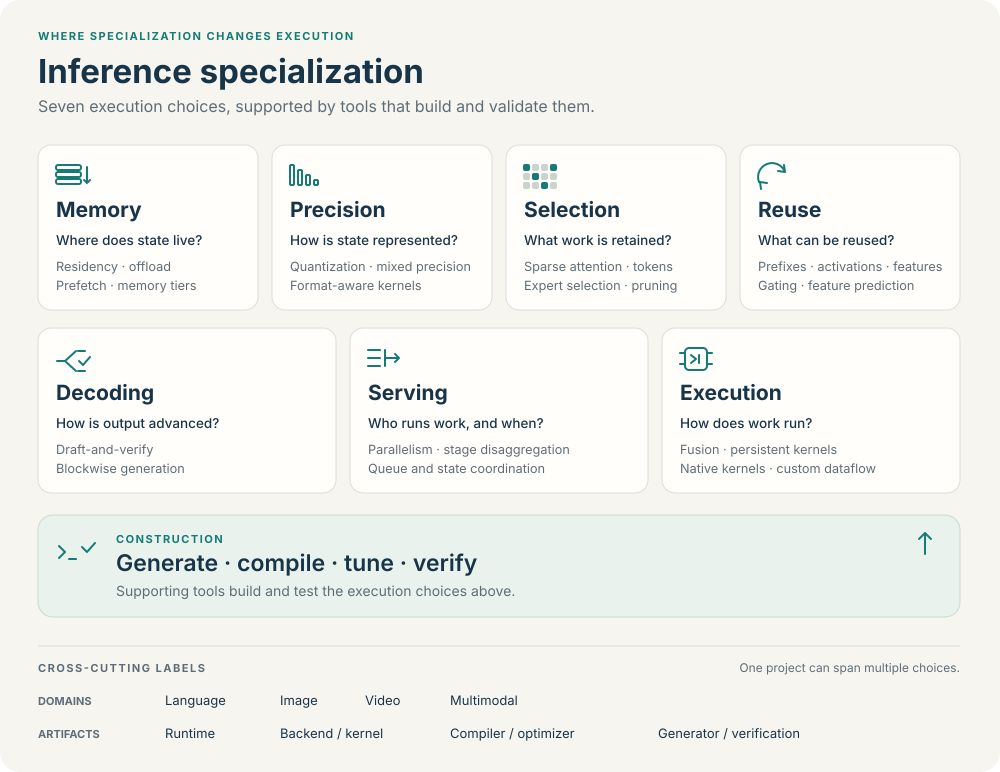
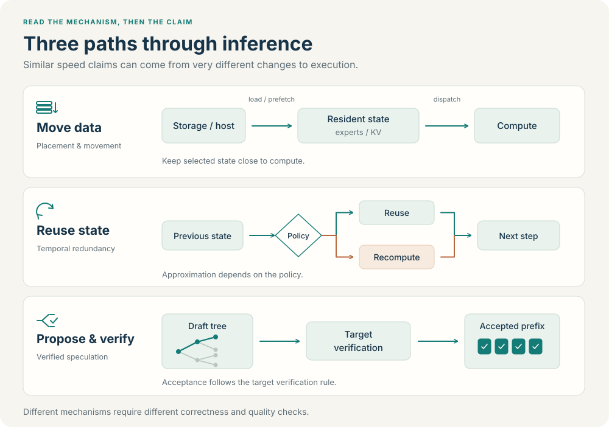

# Taxonomy: inference specialization

This survey studies **whether the ways specialized execution stacks are built, who can obtain and maintain them, and their economics are changing**. It follows concrete decisions about model execution rather than treating all inference optimization as specialization. AI-assisted construction is one candidate explanation for change; lower total cost is a causal hypothesis to test, not an inclusion rule or an established result.

Start with the [selected cases](cases.md). Each case connects a reason to build a separate execution path with the decisions it controls, the infrastructure it reuses, the generality it gives up, the construction work actually performed, and the costs that remain unknown. The broader [project index](systems.md) and [mechanism catalog](catalog.md) preserve historical context, alternative routes, shared infrastructure and comparison baselines.

## Survey role: relation to the research question

Each project has one `survey_role`, independently of what kind of software it delivers:

| Survey role | Why the project is included | Reading purpose |
| --- | --- | --- |
| `core` | A direct case for examining the construction, availability or economics of a specialized execution stack | Explain why a separate path was built, which decisions it controls, how it was constructed, and what remains unmeasured |
| `adjacent` | A historical precedent or nearby route that helps establish alternatives, continuity or boundaries | Compare earlier and neighboring designs without claiming that they demonstrate the present hypothesis |
| `foundation` | Shared infrastructure, reusable components, evaluation tools or general reference systems used to build or compare stacks | Trace dependencies, alternative implementations, validation and counterfactual baselines |

These roles describe relevance to the survey, **not quality, maturity, novelty or an ordering of merit**. Age does not decide the role: an older system can be a core case if it directly answers the construction question. AI involvement is neither necessary nor sufficient. A project can be central even when it builds on an existing runtime, compiler or kernel library; building everything from scratch is not required.

A deeply modified fork can be a core case when identifiable model- or device-specific changes control a substantive execution path in the integrated engine. Record the inherited framework and the changed path separately. A renamed repository, build preset or thin wrapper alone does not establish that boundary.

Every `core` project must be linked from at least one selected case. The selected-case layer in [`catalog/cases.json`](../catalog/cases.json), rendered as [case notes](cases.md), is distinct from the repository inventory. A workflow and one or more reported outputs can form a case without becoming duplicate project records. For example, a VibeQwen case should link the relevant MetaInfer workflow and Baseten-reported output evidence instead of inventing another repository row. Preserve the distinction between inspected source, reported output and inaccessible implementation.

## Catalog role: what the project delivers

Records in the [project index](systems.md) retain an independent `catalog_role` describing their software:

| Catalog role | What belongs here | What to inspect first |
| --- | --- | --- |
| `system` | An integrated execution system or specialized backend whose decisions are shaped by identifiable model, device or workload constraints | The changed state/layout/scheduling/execution decision, integration boundary and deployable artifact |
| `construction` | A concrete workflow that builds model- or deployment-specific programs, through direct native implementation, backend integration, compilation/search, agents, or a combination | Its inputs, construction decisions, emitted artifact, validation gates and update process |
| `support` | General reference engines, reusable compilers/DSLs/kernels, mechanism components and evaluation infrastructure | What it supplies to a system or construction workflow, its interface and its limits |

`survey_role` answers **why study this project here**; `catalog_role` answers **what role its software plays**. A `system` may be a core case, an adjacent precedent, or a foundational reference engine. A construction workflow can be core while producing only one subsystem. Neither role replaces `artifact_type`, the eight `family` values, or evidence about the actual artifact.

A compiler may have the `construction` catalog role when the record describes a concrete model-to-deployment workflow, or `support` when it concerns reusable compiler infrastructure. An agent framework does not qualify as a concrete workflow merely because it can write code. `catalog_role=construction` also differs from `family=construction`: the latter is a secondary index for languages, agents and checking tools. A DSL or benchmark can have that family and the `support` catalog role.

Read in this order:

1. **Core cases:** why build another execution path, how was it obtained, and what evidence bears on its cost?
2. **Historical and adjacent routes:** what was already possible, and what alternatives constrain the explanation?
3. **Foundations and mechanisms:** what is reused, what is compared, and which execution changes implement the choice?

The project inventory retains its existing records. Selection for a case note and placement on the homepage are editorial choices, not a claim that every retained project establishes the central hypothesis. Tiny or “nano” teaching reimplementations whose purpose is explaining a standard engine are outside the collection's scope; line count alone is not a criterion, and a small substantive system should be assessed by the same case questions.

## What counts as specialization here?

Optimization alone is too broad a criterion: almost every inference project optimizes something. A useful specialization account connects four elements; a core case must additionally explain the decision to construct a distinct path and the resulting trade-offs:

| Element | Required explanation | Example of an insufficient account |
| --- | --- | --- |
| **Constraint** | An identifiable property of the model, target device, memory budget, shape range, workload or deployment | “Supports LLMs” or a short model list without an execution consequence |
| **Changed execution decision** | What the constraint makes the implementation fix, remove, fuse, place, schedule or generate differently | A claimed speedup, a new wrapper, or enabling a generic flag without tracing its effect |
| **Deployable artifact** | The integrated runtime, backend, executable graph, model library or generated program, including its interface and remaining dependencies | An isolated fast kernel presented as a complete inference engine |
| **Validation and maintenance** | The tested contract and scope, invalidation conditions, fallback and response to model/device/workload changes | A passing demo treated as general correctness or a one-time build treated as sustainable deployment |

This chain is an analysis requirement, not a demand that every cataloged project already satisfy every engineering obligation. Gaps belong in the record's caveat. A mechanism component with a precise constraint and implementation can remain useful `support` when integration into a deployable system is outside its scope. Conversely, a system built on general infrastructure can be specialized if it makes and validates concrete deployment-specific decisions.

For a core case, ask:

- **Why another execution path?** What constraint or missing control motivated it, and why was an existing implementation or extension point insufficient according to the available evidence?
- **What does it control?** Identify ownership of graph structure, state, memory placement, scheduling, kernels, synchronization or service behavior.
- **What is reused and given up?** Name inherited infrastructure and dependencies, along with compatibility, dynamism, portability or service features restricted by the choice.
- **How was it built?** Trace direct implementation, backend adaptation, compilation/search and agent participation to specific work and artifacts. Distinguish authorship disclosures from an implemented generation workflow.
- **What remains unknown?** State missing effort, failed-attempt, verification, integration, porting and maintenance costs. Unknown cost is not zero cost.

For example, a constrained-memory MoE account should identify where experts reside, when they move, how movement interacts with execution, and the integrated inference path. A fixed-device video account should identify the affected graph, shapes, state or iteration schedule and the complete generation boundary. “Uses CUDA” and “accelerates diffusion” alone do not supply those links.

## Eight secondary navigation families

Once the system or construction path is understood, the mechanism families help find related techniques. A record has one editorial primary `family` and multiple `mechanisms`. The family is neither a quality ranking nor a claim that the project implements only one mechanism.

| ID | Organizing question | Typical mechanisms |
| --- | --- | --- |
| `memory` | What stays close to compute, and when does it move? | Weight/expert/KV residency, paging, offload, prefetch, transfer overlap, memory planning and layouts |
| `precision` | How is each value represented and computed? | Weight/activation/KV quantization, mixed precision, low-bit formats and fused dequantization |
| `selection` | Which computation or state can be omitted? | Sparse attention, token/neuron selection, expert dropping, KV eviction and selective execution |
| `reuse` | Which earlier results can be used again? | Prefix/KV sharing, invariant features, cross-attention caches and diffusion feature reuse |
| `decoding` | How does generation advance? | Draft-and-verify decoding, multi-token proposals, block and parallel generation |
| `serving` | Which request or device executes what, and when? | Batching, chunked prefill, request scheduling, tensor/sequence/context/pipeline parallelism and disaggregation |
| `execution` | How does a graph become an executable? | Compilation, graph/operator fusion, kernel specialization, persistent execution, graph replay and native backends |
| `construction` | How are specialized programs built and checked? | Coding agents, kernel DSLs, configuration search, profiling, differential validation and benchmark infrastructure |

The first seven families describe execution mechanisms. **The eighth, `construction`, groups construction and validation tools rather than an execution mechanism.** A language, agent, or benchmark does not itself establish an inference speedup. Inspect the program it produces or evaluates, its integration, and its validation path. This family can contain both concrete construction workflows and reusable support tools; `catalog_role` distinguishes their presentation.

The family definitions and navigation examples are stored in [the schema](../catalog/schema.json). The [catalog](catalog.md) exposes the individual records and their evidence.

## Independent dimensions

| Dimension | What it records | What it must not imply |
| --- | --- | --- |
| `survey_role` | Core case, historical/adjacent route, or shared foundation/reference | Research relevance is not quality, age or AI authorship |
| `catalog_role` | System, concrete construction workflow, or supporting infrastructure | A software role is not its relevance to the central hypothesis |
| `family` | The primary mechanism or tool family used for secondary navigation | A family is not the project's full scope or its display role |
| `domains` | Text, image, video, audio, multimodal, or general-purpose coverage | A domain is not an optimization mechanism; example coverage is not universal support |
| `constraints` | Model structure, hardware, memory capacity, shapes, workload, or deployment assumptions | A narrow model list alone does not establish substantive specialization |
| `mechanisms` | Multiple concrete actions, such as KV offload, fused dequantization, or persistent workers | Membership in the primary family does not exhaust the implementation |
| `artifact_type` | The component delivered by the cataloged project | A kernel library is not automatically a full runtime |
| `semantic_effect` | Changes and assumptions that require evaluation | A tag is not a correctness certificate |
| `source_visibility` | Relevant code access and disclosed restrictions | Public visibility does not establish licensing completeness, correctness, or maturity |

A constraint explains **why** specialization is useful; a mechanism explains **what changes**. For example, limited VRAM is a constraint, while expert offload is a mechanism. Both an LLM and a video denoiser can use fusion, quantization, reuse, and distributed execution, but their state and quality contracts differ.

## Artifact types

- `runtime`: manages integrated execution, state, data movement, or requests for a workload.
- `backend`: implements a substantial execution subsystem used by another runtime.
- `compiler`: transforms graphs or programs into executable artifacts.
- `optimizer`: rewrites or selects configurations for an existing execution stack.
- `kernel-library`: supplies operator or kernel implementations for integration elsewhere.
- `research-prototype`: packages an experimental system whose component boundaries or supported scope remain specific to the demonstrated setup.
- `generator`: constructs source, kernels, graphs, or engines, including agent-driven workflows.
- `verification`: evaluates correctness, quality, or performance of candidate implementations.

These are component descriptions, not a maturity ladder. Choose the type of the component being cataloged and describe other roles in the mechanism summary or caveat. A project may evolve: for example, FastKernels has both evaluation machinery and a documented [minimal serving framework](https://github.com/Snowflake-AI-Research/fastkernels/blob/HEAD/docs/serving-framework-guide.md). Its evaluation role and serving coverage should be stated separately.

## Semantic effects: what must be evaluated

`semantic_effect` is multi-valued. It describes evaluation obligations, rather than declaring an implementation exact or safe.

| Value | Meaning | Required attention |
| --- | --- | --- |
| `layout-scheduling` | Changes placement, layout, scheduling, fusion, or execution order while intending to preserve the computation | Indexing, state transitions, synchronization, numerical reduction order, and supported shapes |
| `reduced-precision` | Changes the representation or arithmetic precision of weights, activations, or state | Formats, calibration, accumulation precision, error and task quality |
| `selective-approximation` | Omits work or state that the reference computation would use | Selection policy, budgets, fallback behavior and workload-dependent quality |
| `stale-state` | Reuses an earlier result, or predicts a current result from earlier states | Refresh policy, accumulated drift, failure cases and quality across trajectories |
| `verified-proposals` | Generates candidates whose acceptance is checked by a target or verifier | Acceptance/rejection and correction rules, target distribution or output contract, and verifier implementation |
| `trained-model` | Uses changed, trained, or distilled model components or weights | Model identity, training assumptions, and attribution of speed/quality changes |
| `configurable` | Different enabled modes have materially different effects | The exact active configuration; add the specific applicable effect tags where known |
| `tool-dependent` | Effects depend on the program generated, selected, or tested by a tool | The emitted artifact, integration, validation coverage and measured configuration |

Exact prefix reuse, under valid cache keys and compatible model state, is not the same as substituting an earlier diffusion residual. The latter needs a stale-state quality assessment. This tag also covers history-based feature prediction: TaylorSeer extrapolates features rather than simply returning a cached value. Similarly, a draft-and-verify interface does not by itself prove distribution preservation: the acceptance and correction implementation matters. A trained draft model and a trained replacement target also have different implications; record which component changed.

## Cross-domain examples and classification boundaries

| Situation | Classification and boundary |
| --- | --- |
| MoE experts do not fit in VRAM | Residency and offload are `memory`. Skipping routed experts is `selection`; it introduces a different evaluation obligation. Ordinary model-defined routing is not automatically an additional approximation. |
| An LLM changes its KV handling | Offload is `memory`, low-bit KV is `precision`, compatible prefix reuse is `reuse`, and retaining only selected KV entries is `selection`. These may coexist. |
| Low-bit LLM matmul and low-bit diffusion layers | Both can combine `precision` with fused `execution`. Quantization formats, accumulation and model quality must be checked separately for each implementation. |
| A video generator reuses denoising features | Cross-step substitution belongs to `reuse`, often with `stale-state`. Changing block-generation order belongs to `decoding`; VAE chunking may instead concern `memory` and `execution`. |
| A system uses persistent GPU workers and tensor parallelism | Persistent workers concern `execution`; distributing tensor work concerns `serving`. Neither mechanism should hide the other. Mirage exposes a concrete [persistent-kernel implementation](https://github.com/mirage-project/mirage/blob/mpk/include/mirage/persistent_kernel/persistent_kernel.cuh). |
| A compiler lowers models while a DSL builds kernels | A model-to-executable path can use `execution` as its primary family; a reusable language can use `construction`. MLC-LLM's [compiler pipeline](https://github.com/mlc-ai/mlc-llm/blob/HEAD/python/mlc_llm/compiler_pass/pipeline.py) names concrete fusion, dequantization and dispatch passes. The word “compiler” alone does not specify their effects. |
| An agent produces an inference engine | A concrete generator workflow can have the `construction` role; the emitted engine has its own mechanisms and validation obligations. MetaInfer, KernelAgent and Sol-Engine expose different construction scopes. A generated kernel does not establish a complete serving system. |

Broad projects can reasonably fit several navigation groups. Sol-Engine, for example, exposes an agent workflow and concrete model runtimes; using the `construction` role emphasizes how it builds specialized engines, while its mechanism tags must retain the runtime's fusion, caching, attention and precision behavior. A future record focused only on one deployed runtime could have the `system` role and a different primary family without contradicting this classification.

## Assigning the independent roles and primary family

1. Identify the component and trace constraint → execution decision → artifact → validation and maintenance.
2. Choose `survey_role` from its relationship to the construction, availability and economics question. Explain the decision without using age, AI presence, star count or code size as a substitute.
3. Choose `catalog_role` from the delivered software: integrated system, concrete construction workflow, or reusable support.
4. Inspect dispatch and fallback conditions and select the primary mechanism/tool `family`; retain other mechanisms, constraints and semantic effects independently.
5. For a selected case, document why another path was built, controlled decisions, reuse and sacrificed generality, construction participation and unknown costs in `catalog/cases.json`.
6. Record ambiguous boundaries and missing evidence in the caveat; revise the assignments when scope or evidence changes.

Counts by either role or primary family describe this survey's editorial organization. They do not measure research importance, prevalence, quality, or mutually exclusive technical populations, and they are not the main reason to read the collection. Follow the [evidence policy](evidence-policy.md) when converting observations into implementation, economic or causal claims.
